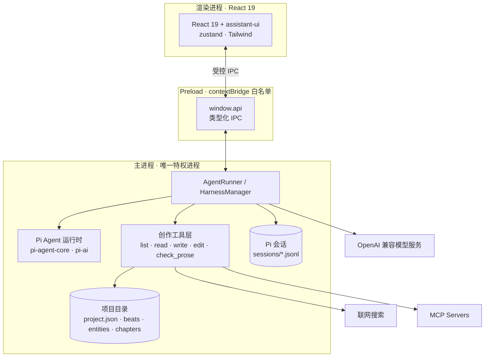

<div align="center">
  

# 造梦师 DreamAgent

**本地优先的 AI 长篇创作工作台**

大纲、设定、正文与 AI 协作，都在同一个桌面应用里。

  <p>
    
    
    
    
    
    
    
    
    
  </p>

  <p>
    <a href="#为什么是造梦师">为什么是造梦师</a> ·
    <a href="#核心能力">核心能力</a> ·
    <a href="#架构">架构</a> ·
    <a href="#下载与安装">下载安装</a> ·
    <a href="#本地开发">本地开发</a> ·
    <a href="#数据目录">数据目录</a> ·
    <a href="#内置技能">内置技能</a> ·
    <a href="changelogs/v0.1.7.md">更新日志</a>
  </p>
</div>

---

DreamAgent（造梦师）是一个围绕真实创作项目组织 AI 的桌面工作台。它基于 Electron、React 19 与 Pi Agent 运行时（`pi-agent-core` / `pi-ai`）构建：主题、卷纲、章纲和场景放在节点里，人物、地点、势力与世界观放在实体里，最终正文放在文章中。AI 通过项目工具读取上下文、维护双链，并直接落笔修改项目。

项目资料、会话与配置保存在本机；模型请求只发往你主动配置的 OpenAI 兼容服务。

## 为什么是造梦师

- **项目化，而不是聊天窗口** —— 大纲、设定、正文各有明确位置，AI 的每次读写都落在项目结构里，而不是散落在对话记录中。
- **本地文件为准** —— 项目就是一组普通目录与 JSON 文件，可以备份、迁移，也可以直接纳入 Git 管理。
- **可执行的创作工具** —— Agent 不只聊天，它用 `list` / `read` / `write` / `edit` / `check_prose` 等工具真正创建和修改内容。
- **克制的数据面** —— API Key 由主进程管理，渲染进程启用上下文隔离，只通过受控 IPC 使用本地能力。

## 核心能力

| 分区 | 能力 |
| --- | --- |
| 📋 大纲与节点 | 用多级树形节点组织主题、卷纲、章纲、场景和待办，支持状态流转 |
| 🧑‍🤝‍🧑 设定与实体 | 管理人物、地点、势力、物件和世界观条目，支持多级分类 |
| 🔗 双链与引用 | 节点、实体和文章之间通过 `@` 提及建立双向链接，追踪出入链 |
| ✍️ 正文创作 | 用文件夹组织文章，在独立编辑区完成正文，并关联来源节点与设定 |
| 💬 AI 协作 | 多轮创作会话、流式输出、历史会话、重新生成、追问、插话、排队与中止 |
| 🧰 创作工具 | `list` / `read` / `write` / `edit` / `delete` / `check_prose`，以及待办、技能、联网和 MCP 工具 |
| 🧩 模型与扩展 | 多个 OpenAI 兼容供应商、默认模型与思考等级、远程模型列表、多模态桥接 |
| 🌐 搜索与 MCP | Tavily、Exa、Serper、Brave、SearXNG，MCP Server 接入与单工具开关 |
| 📊 创作复盘 | 文字产出与 Token 消耗热力图、最近项目和会话入口 |
| 🎨 界面 | 无边框窗口、浅色 / 深色 / 跟随系统主题 |

## 架构



关键设计：主进程独占 Agent 运行时与本地文件访问，渲染进程只通过 `contextBridge` 暴露的类型化 API 消费能力；模型配置、搜索配置和 MCP 配置同样由主进程管理。

## 下载与安装

前往 [GitHub Releases](https://github.com/qgming/dreamagent/releases) 下载最新版本。

| 平台                | 发布产物                 |
| ------------------- | ------------------------ |
| Windows x64         | NSIS 安装程序 `.exe`     |
| macOS Apple Silicon | 磁盘镜像 `.dmg`、`.zip`  |
| Linux x64           | `.AppImage`、`.deb`      |

应用启动后会定期检查 GitHub Releases。也可以打开「设置 -> 关于」手动检查；发现版本后可在应用内下载，并在下载完成后重启安装。

> 当前发布包未配置商业代码签名。Windows SmartScreen 或 macOS Gatekeeper 可能在首次运行时显示来源提示。

## 本地开发

### 环境要求

- Node.js 20+
- npm 10+
- Windows、macOS 或 Linux 桌面环境

### 启动项目

```bash
git clone https://github.com/qgming/dreamagent.git
cd dreamagent
npm install
npm run dev
```

项目的 `.npmrc` 已配置 npm、Electron 和 electron-builder 国内镜像。需要使用官方源时，请在本机 npm 配置或环境变量中覆盖。

### 常用命令

| 命令                 | 说明                               |
| -------------------- | ---------------------------------- |
| `npm run dev`        | 启动 Electron 开发环境与热更新     |
| `npm run typecheck`  | 检查主进程、preload 和渲染进程类型 |
| `npm run build`      | 类型检查并构建到 `out/`            |
| `npm run preview`    | 运行构建后的应用                   |
| `npm test`           | 运行 Vitest 测试集                 |
| `npm run test:watch` | 以监听模式运行测试                 |
| `npm run dist`       | 构建当前平台安装包                 |
| `npm run dist:win`   | 构建 Windows 安装包                |
| `npm run dist:mac`   | 构建 macOS 安装包                  |
| `npm run dist:linux` | 构建 Linux 安装包                  |

## 首次配置

1. 启动 DreamAgent，打开「设置 -> 模型」。
2. 添加模型供应商，填写 Base URL 和 API Key。
3. 读取或手动添加模型，并设置默认模型与思考等级。
4. 按需配置联网搜索、技能和 MCP Server。
5. 返回首页创建项目，从节点、实体或创作工作区开始。

如果主模型不支持图片输入，可以在「模型」设置中指定一个视觉模型作为多模态桥接；图片会先转成中文描述，再随文本发送给主模型。

## 数据目录

项目默认保存在系统文档目录下的 `造梦师/projects`，可在应用内更改项目库根目录。应用配置保存在 Electron `userData` 目录，开发模式下以 Electron 实际应用名为准。

```text
<项目库>/
└── <项目>/
    ├── project.json           # 项目元数据与梗概
    ├── index.json             # 节点 / 实体 / 文章索引
    ├── activity.json          # 文字产出与 Token 用量台账
    ├── beats/                 # 节点
    ├── entities/              # 实体
    ├── documents/chapters/    # 文章（支持文件夹层级）
    └── sessions/              # Pi 会话（JSONL）
```

```text
应用配置（userData）
├── library.json               # 项目库根目录
├── llm-settings.json          # 模型服务、默认模型、思考等级与多模态桥接
├── web-search-settings.json   # 联网搜索配置
├── mcp-servers.json           # MCP Server 配置
├── skills/                    # 内置与自定义技能
└── cache/model-logos/         # 模型图标缓存
```

请注意：启用模型、联网搜索或 MCP 服务后，相应请求会发送给所配置的第三方服务，具体数据策略取决于服务提供方。

## 内置技能

应用随包分发以下 `SKILL.md` 技能，可在「技能」页启用或查看：

| 技能 | 用途 |
| --- | --- |
| `long-write` 长篇写作 | 卷纲、章纲、人物设定与正文续写的主路径 |
| `short-write` 短篇写作 | 短篇构思、反转设计与一篇完结 |
| `prose-craft` 正文笔法 | 视角、动作、对白、信息边界与章末钩 |
| `human-writing` 活人感写作 | 通用中文创作与改稿，按材料与语气组织内容 |
| `story-humanizer` 故事人味化 | 网络小说口语化、听读化复核与安全改写 |
| `continuity-audit` 连续性审稿 | 查因果、人设、伏笔、时间线与信息边界 |
| `title-blurb` 起名简介 | 书名、简介、标签与上架包装 |
| `dreamagent-guide` 使用指南 | 三类对象、双链语法与工具调用顺序 |
| `skill-creator` 技能制作 | 制作可导入造梦师的 `SKILL.md` 技能包 |

## 快捷键

| 快捷键 | 动作 |
| --- | --- |
| `Enter` | 发送消息 |
| `Shift + Enter` | 换行 |
| 运行中 `Enter` | 插话，立刻引导当前回复 |
| 运行中 `Alt + Enter` | 排队，等当前回合结束后发送 |

在创作工作区输入 `@` 可以引用节点或实体，建立双链。

## 项目结构

```text
dreamagent/
├── .github/workflows/       # GitHub Actions 云端发布
├── build/                   # 应用图标与打包资源
├── changelogs/              # 各版本 GitHub Release 更新日志
├── resources/
│   ├── prompts/             # 内置提示词分类
│   └── skills/              # 随应用分发的内置技能
├── scripts/                 # 开发与资源维护脚本
├── src/
│   ├── main/                # Electron 主进程、服务和 IPC
│   ├── preload/             # 安全的渲染进程 API 桥接
│   ├── renderer/            # React 页面、组件和状态管理
│   └── shared/              # 主进程与渲染进程共享类型
├── tests/                   # Vitest 测试
├── electron-builder.yml     # 跨平台安装包与更新源配置
├── electron.vite.config.ts  # Electron Vite 构建配置
└── package.json
```

## 发布版本

项目通过 GitHub Actions 构建并发布 Windows、macOS 和 Linux 安装包。发布前需要同时更新版本号和版本日志：

```bash
# 例如发布 0.2.0
npm version 0.2.0 --no-git-tag-version
# 新建 changelogs/v0.2.0.md

git add package.json package-lock.json changelogs/v0.2.0.md
git commit -m "release: v0.2.0"
git tag v0.2.0
git push origin main --tags
```

推送 `v*.*.*` 标签后，`.github/workflows/release.yml` 会：

1. 校验标签与 `package.json` 版本完全一致。
2. 在 GitHub 托管的 Windows、macOS 和 Linux 环境并行构建。
3. 上传安装包、blockmap 和 `latest*.yml` 更新元数据。
4. 读取 `changelogs/vX.Y.Z.md` 并创建 GitHub Release。

也可以在 GitHub Actions 页面手动运行 Release 工作流并输入版本标签。工作流使用仓库自带的 `GITHUB_TOKEN`，不需要额外配置发布 Token。

### 自动更新约束

- 不要删除 Release 中的 `latest*.yml` 或 `.blockmap` 文件。
- Release 必须是公开且非草稿状态，客户端才能读取。
- `package.json`、Git 标签和更新日志文件名必须使用同一个版本。
- macOS 正式分发建议配置 Developer ID 签名与公证。

## 参与贡献

欢迎提交 Issue 和 Pull Request。适合贡献的方向包括创作工具、内置技能、模型兼容、MCP 集成、编辑体验以及跨平台发布。

## 许可证

项目以 [MIT License](LICENSE) 发布。
